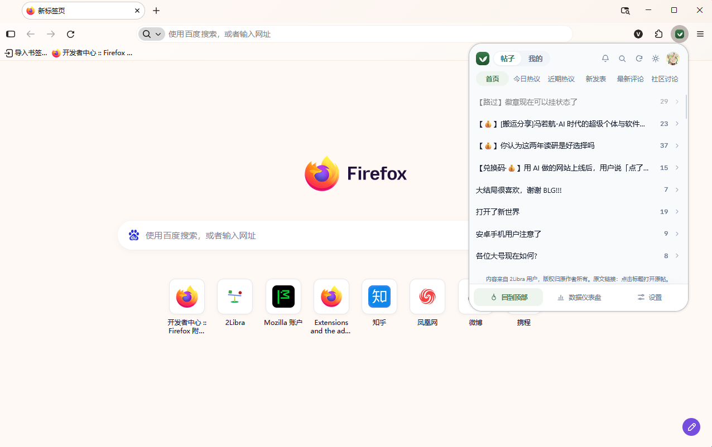
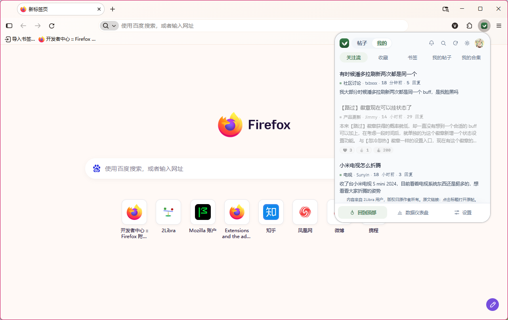
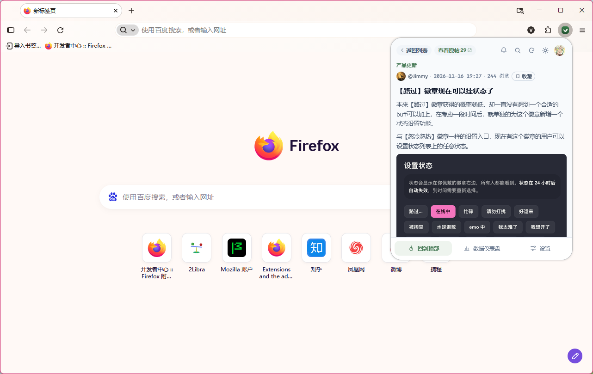
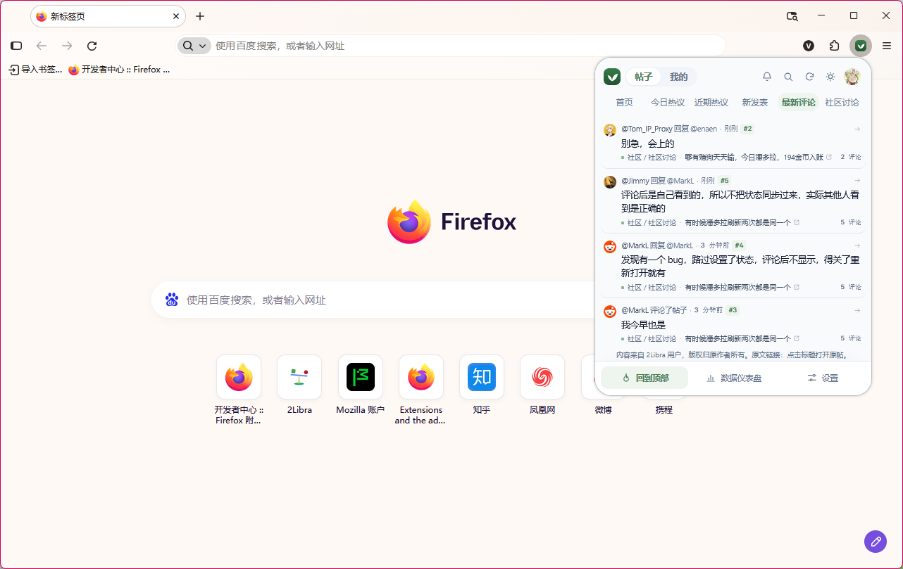
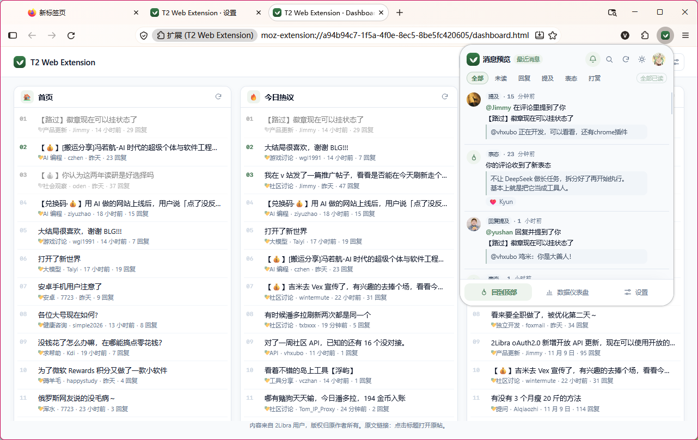
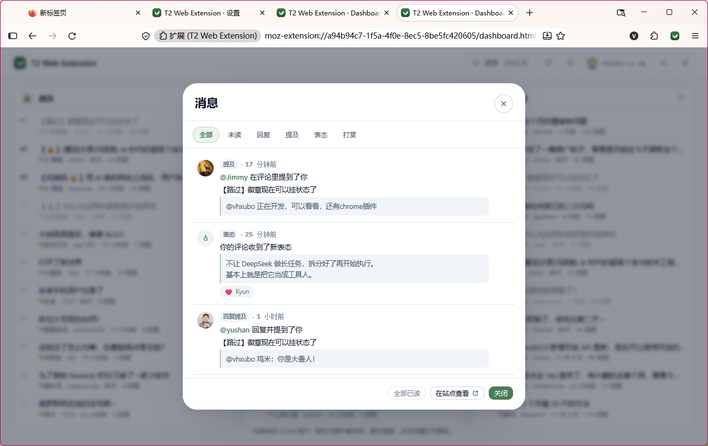
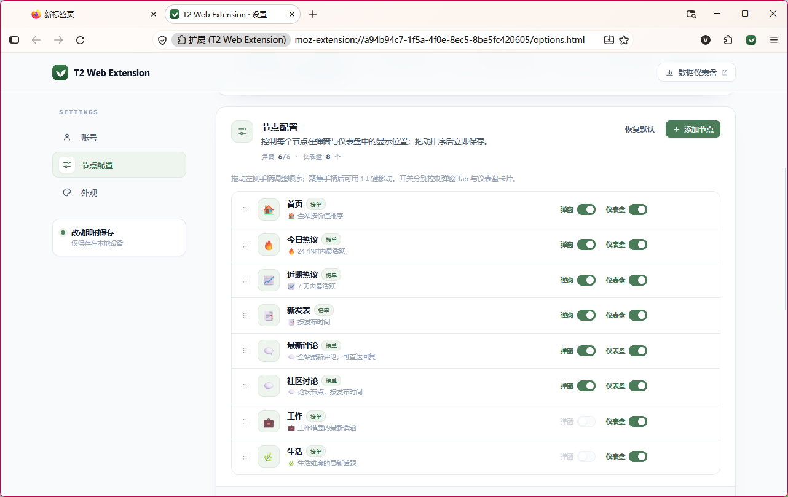
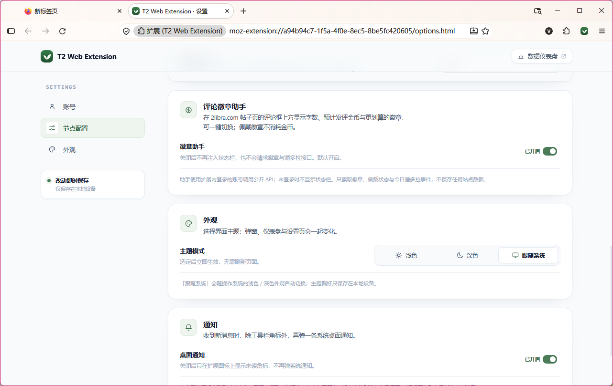
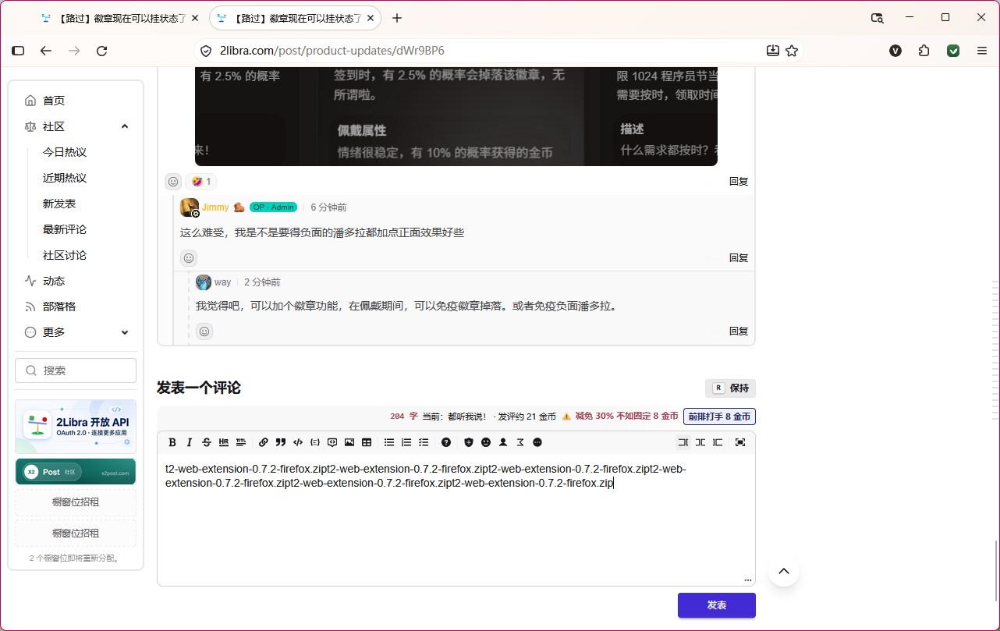

# T2 Web Extension

> 作者：vhxubo · [vhxubo@gmail.com](mailto:vhxubo@gmail.com)

T2 Web Extension 让你在工具栏弹窗里快速扫一眼帖子，或者在新标签页里把关注的榜单和节点铺成可配置的看板。
弹窗最多放 6 个 Tab，仪表盘不限数量；每个视图都能单独控制显隐、拖动排序，并随时添加全站、父节点或具体子节点。

基于 [开放 API v1](https://r2.2libra.com/openapi/v1/index.md)，以只读浏览为主；写操作仅限消息已读（单条 / 全部）、帖子收藏与徽章佩戴 / 摘下。

## 预览

|  |  |  |
| :---: | :---: | :---: |
|  |  |  |
|  |  |  |

## 合规

本扩展严格遵守站点 [第三方应用接入说明](https://r2.2libra.com/openapi/v1/terms.md)：

- **权限最小化**：仅申请与功能一一对应的权限，不申请任何金币写入（`write:economy`）或上传类权限；经济信息只读取今日盲盒状态，用于评论费用提示。
- **公开客户端**：采用授权码 + PKCE 流程，代码中不含任何密钥。
- **令牌安全**：登录令牌只保存在扩展本地存储（网页脚本读不到），不写入日志，仅在本地用于接口调用。
- **内容署名**：列表每行展示作者与标题并链回原帖，底部固定「内容来自 2Libra 用户…原文链接」声明。
- **开发者声明**：设置页与页脚常驻「本应用由 vhxubo 独立开发运营，与 2Libra 无隶属或合作关系」。
- **可撤销**：收到授权失效即清除本地令牌；退出登录同时清除令牌与资料缓存。
- **不滥用**：仅做展示型摘要，不落库、不提供全量导出、不批量抓取、不刷量。

## 安装

- **Firefox**：已在 [Firefox Add-ons（AMO）](https://addons.mozilla.org/zh-CN/firefox/addon/t2-web-extension/) 正式上架，可直接安装。
- **Edge**：已在 [Microsoft Edge Add-ons](https://microsoftedge.microsoft.com/addons/detail/t2-web-extension/hfmicgegebccpcahiipnmaokhibhiknj) 正式上架，可直接安装。
- **Chrome 等其它 Chromium 系**：暂未上架商店。可下载已签名的内置 ID 版本并加载已解压的扩展程序：
  - Chrome 打开 `chrome://extensions` → 开启「开发者模式」→「加载已解压的扩展程序」→ 选择扩展目录。
- **从源码构建**：见仓库 `wxt.config.ts` 与构建脚本（开发者向）。需自行将 `clientId` 改为你在站点申请的 OAuth 应用客户端 ID，并完成对应的 OAuth 应用配置（回调地址、权限等），否则登录功能不可用。

### 打上架包（开发者）

```bash
bun run release
```

一条命令构建全部上架产物，**`releases/` 里的文件就是最终要上传的东西**（每次运行前自动清空）：

| 文件 | 上传目标 |
| --- | --- |
| `t2-chrome-store-<version>.zip` | Chrome Web Store / Microsoft Edge Add-ons（keyless，不带 `manifest.key`） |
| `t2-firefox-<version>.zip` | Firefox Add-ons（AMO） |
| `t2-sources-<version>.zip` | AMO 要求的源码包 |

中间构建产物留在被 gitignore 的 `.output/`，不用管。注意商店包的扩展 ID 由商店生成，不等于本地钉死的 ID，需按商店给出的 ID 在站点另登记一条 OAuth 回调地址（见 `wxt.config.ts` 顶部说明）。

## 功能

- **弹窗**：未登录时显示标题与快捷图标（消息 / 搜索 / 刷新 / 深浅色 / 账号）；登录后标题位置换成一级 Tab `帖子 | 我的`。`帖子` 下是可配置视图（首页 / 今日热议 / 近期热议 / 新发表 / 最新评论 / 社区讨论，最多 6 个）；`我的` 固定 5 个系统视图（关注流 / 收藏 / 书签 / 我的帖子 / 我的合集）。点帖子在新标签页打开原帖。
- **帖子详情**：列表行末的箭头进入独立详情页，展示完整标题、类型、分区、作者、发布时间与正文（markdown 安全渲染）。有金币池的帖子会标出剩余金币及「已领完 / 已结束 / 已过期」状态。`Esc` 或「返回列表」回到原滚动位置。详情不展示评论，底部「到原帖看评论」直达站点；登录后可在详情页直接收藏 / 取消收藏。
- **底部 Dock**：`回到顶部`、`数据仪表盘`（登录后有未读消息时显示小红点）、`设置`。
- **完整页面（仪表盘）**：可配置卡片按宽度自动铺列、数量不限，每张卡片独立滚动 / 刷新，也可一次刷新全部；顶栏铃铛打开消息中心。
- **最新评论**：`最新评论` 视图展示「谁回复了谁、回复正文、被引用的父评论、所属节点与原帖」，点正文跳到站点的这条回复，点标题跳到原帖。
- **搜索**：弹窗与仪表盘都提供搜索入口（`Ctrl / ⌘ K`），可切换帖子 / 用户 / 节点 / 标签，登录后还可搜自己的收藏。结果在页面内缓存 5 分钟；搜索接口有单独额度限制，额度用完会显示等待时间。
- **设置页**：账号、节点配置与外观集中在一个独立标签页（同时也是扩展的选项页），改动即时保存，无需「保存」按钮。
- **评论徽章助手**：在 2libra.com 帖子页 / 帖子弹窗的评论框上方实时显示字数、预计发评金币与最划算的徽章，可一键切换（佩戴徽章不扣金币）；识别固定扣费、按比例减免与潘多拉事件约束。设置页可关闭，默认开启，需在扩展内登录后使用。
- **节点配置**：每个视图可分别开关「弹窗」与「仪表盘」，拖动排序或上下调整；内置榜单可隐藏不可删除，全站 / 父节点 / 子节点可随时添加或移除。设置里实时显示两边各放了多少个。
- **默认进入**：在设置页选择弹窗打开时先显示哪个视图；在弹窗里切换 Tab 只影响当次浏览，不会改写默认值。
- **未读消息**：登录后实时接收新消息提醒，工具栏图标、弹窗与仪表盘三处共享同一份未读状态并即时更新；消息中心支持「全部 / 未读 / 回复 / 提及 / 表态 / 打赏」分段筛选，可单条或一键全部已读。
- **登录**：通过站点 OAuth 授权登录；令牌过期自动刷新。成功后解析并缓存当前用户资料（含头像）。
- **外观**：支持 `浅色 / 深色 / 跟随系统`，所有页面共用同一份偏好；弹窗 Header 也可一键切换深浅色。
- **视觉**：无衬线字体、等宽数字、键盘可操作、尊重「减少动效」系统设置。

## 登录

扩展为「无服务端」形态，登录通过站点 OAuth 授权完成，流程在独立设置页内进行（避免弹窗失焦关闭）：

1. 在设置页点击登录，按提示在站点完成授权；
2. 授权后扩展即可读取登录态相关功能（关注流、收藏、未读消息、收藏帖子）；
3. 退出登录会清除本地令牌与资料缓存。

> 若未配置 OAuth 应用，扩展仍可匿名浏览，登录按钮会被禁用。

## 节点配置

一个「视图」既是弹窗里的一个 Tab，也是仪表盘上的一张卡片。可配置的视图包括：

- 8 个内置榜单：首页、今日热议、近期热议、新发表、最新评论、社区讨论、工作维度、生活维度（可隐藏 / 排序，可被自定义节点替代）；
- `全站`、`父节点（含全部子节点）`、`具体子节点`：通过「添加节点」按名称 / slug 筛选添加，可随时移除；
- `我的` 系统视图：关注流 / 收藏 / 书签 / 我的帖子 / 我的合集，登录后固定出现在一级 Tab「我的」下，不占弹窗名额。

操作要点：

- **分别显隐**：弹窗与仪表盘各一个开关，两个都关即完全隐藏；
- **排序**：拖动手柄或上下箭头，键盘也可操作；
- **上限**：弹窗 Tab 限制为 6 个，仪表盘不限；
- **失效节点**：节点被下线或改名后配置仍保留，设置里标「未找到」，提示到节点配置移除；
- **恢复默认**：一键回到八个内置榜单全部展示的初始状态。

## 搜索

弹窗与仪表盘都提供搜索入口，可切换帖子 / 用户 / 节点 / 标签，登录后还可搜索自己的收藏。关键词至少 2 个字符，输入停顿后才会发请求；结果只读、不写数据，点击在新标签页打开原帖、用户主页、节点页或标签页。

## 帖子与收藏

从列表行末进入二级详情页查看完整正文（markdown 安全渲染，不注入 HTML）；详情不展示评论，统一到站点原帖查看。登录后可在详情页收藏 / 取消收藏；未登录或旧令牌缺少相应权限时引导重新授权。已读过的条目在列表中置灰。

## 评论徽章助手

在 2libra.com 的帖子详情页与帖子弹窗里，助手会在评论框上方插入一条状态栏：

- 实时显示字数与当前徽章下的预计发评金币；
- 只在算出更好选择时给出切换按钮，并优先按实际佩戴的徽章计价；
- 识别「固定扣费」与「按比例减免」两类徽章，同类多枚会同时参与比较；
- 潘多拉事件优先：徽章锁定、固定费用、字数门槛、小表情等约束会覆盖徽章建议；
- 持有「走个面」时，状态栏最左侧提供活跃度加成的佩戴 / 摘下开关；
- 佩戴 / 摘下徽章不消耗金币，点击后直接生效（请求带幂等键，重复点击不会重复提交）。

开关位于设置页「评论徽章助手」，默认开启；关闭后不再注入状态栏，也不会请求徽章与潘多拉接口。助手使用扩展内登录的账号调用公开 API（`/api/v1/me/badges`、`/api/v1/pandora/today` 等），未登录时不显示状态栏；只读取徽章、佩戴状态与今日潘多拉事件，不保存任何站点数据。

徽章佩戴走 `POST /api/v1/me/badges/:badgeId/equip`（官方文档明确不消耗金币），摘下走 `DELETE`，两者都带 `Idempotency-Key`。今日盲盒接口需要 `read:economy` 权限且应用已开通盲盒能力；未开通时助手会自动跳过潘多拉提示，徽章费用估算不受影响。

## 数据与安全

- 列表只展示标题与元信息，正文仅在进入详情时按需拉取并安全渲染，不把 HTML 直接注入页面。
- 登录令牌只保存在扩展本地存储，网页脚本无法读取；退出登录即清除。
- 读接口本就公开，登录后的令牌按标准方式传递；写操作（消息已读、收藏）的权限由令牌控制。
- 系统桌面通知：收到新消息时弹一条通知（成串到达会合并），可在设置里关闭。

## 已知边界

- 登录依赖已申请并通过审核的 OAuth 应用；未配置时所有内容仍可匿名浏览，登录按钮禁用。
- 未读消息角标依赖授权时勾选的对应权限；若应用未开通，角标与消息中心会提示重新授权。
- 搜索接口有单独额度限制，扩展只展示第一页，查看更多结果请到站点内搜索。
- 节点视图首次打开会拉取节点树并短期缓存；接口失败时回退旧缓存，缓存里没有的节点会标「未找到」。
- 除消息已读、帖子收藏与徽章佩戴外，发帖 / 评论等其它写操作请到站点内处理。
- Firefox 版本沿用了部分 Chromium 专属权限，弹窗、新标签页、登录回调与角标等仍需更多实测。

## 更新日志

各版本的新增、变更与修复见 [CHANGELOG.md](./CHANGELOG.md)。
